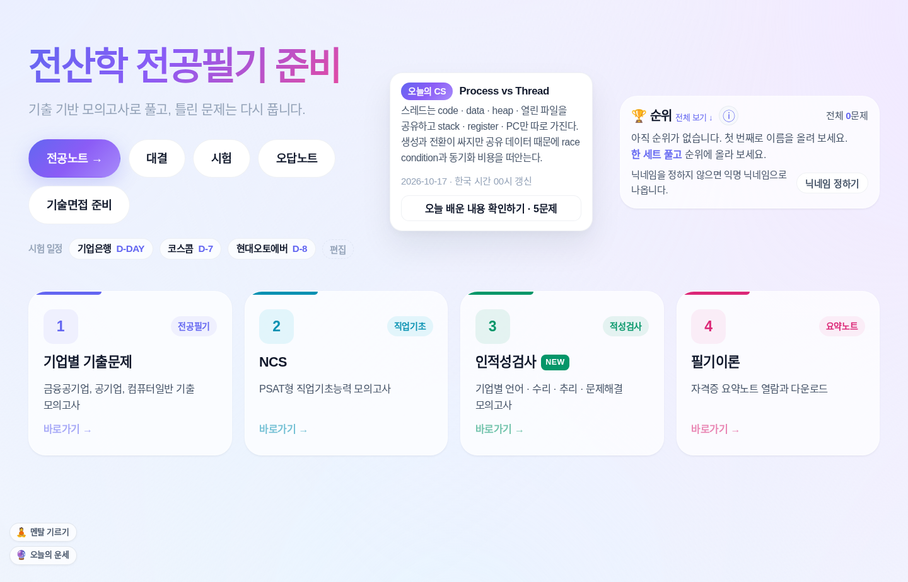
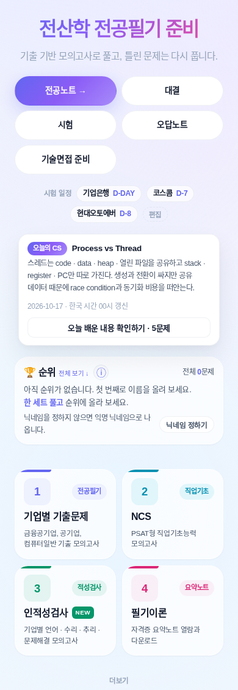
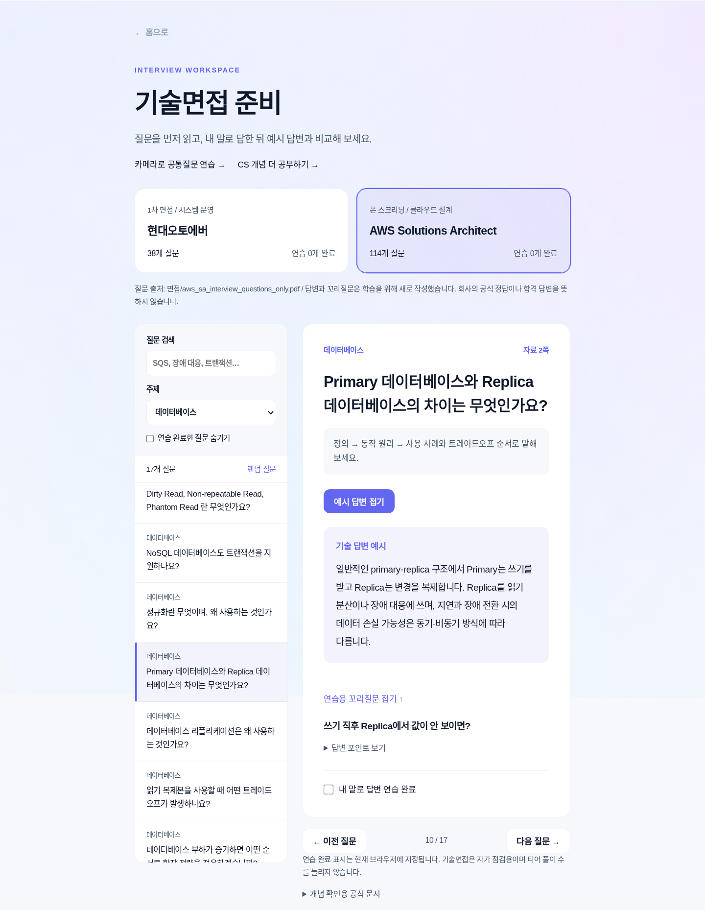

<div align="center">

# CS Study Platform

### 기출을 풀고, 약점을 복습하고, 면접 답변까지 준비하는 공간

전산학 전공필기부터 기술면접까지 학습 흐름을 연결합니다.

[사이트 열기](https://cs-study-platform.vercel.app/) | [기술면접 준비](https://cs-study-platform.vercel.app/technical-interview) | [개발 문서](#개발-문서)


</div>

<br>



<p align="center"><sub>실제 프론트엔드를 로컬에서 실행한 화면입니다. 운영 사용자의 개인정보 대신 예시 API 응답을 사용했습니다.</sub></p>

<details>
<summary>모바일 화면 보기</summary>
<p align="center"></p>
</details>

## 하나의 흐름으로 공부하기

| 단계 | 할 수 있는 일 |
| --- | --- |
| 문제 풀기 | 기업별 기출 경향 문제, 컴퓨터일반, NCS와 인적성 모의고사를 풉니다. |
| 부족한 부분 채우기 | 해설을 확인하고 오답노트에서 기업과 문제집 구분 없이 다시 풉니다. |
| 매일 이어가기 | 오늘의 CS와 공통 확인 문제 5개가 한국 시간 자정에 바뀝니다. |
| 함께 공부하기 | 실시간 채팅에서 공부 중인 사람을 보고 대결을 신청합니다. |
| 성장 확인하기 | 누적 풀이 수와 승급 시험으로 세부 티어를 확인합니다. |
| 말로 설명하기 | 기술면접 질문에 먼저 답해 보고 예시 답변과 꼬리질문으로 점검합니다. |

## 기술면접 준비

업로드한 면접 자료의 질문 152개를 회사와 주제별로 정리했습니다.

| 자료 | 질문 수 | 준비 내용 |
| --- | ---: | --- |
| 현대오토에버 1차 | 38 | 직무 이해, 프로젝트, 배포, 장애 대응과 경험 답변 구성 |
| AWS Solutions Architect 폰 스크리닝 | 114 | 소프트웨어 설계, DB, 네트워크, 스토리지, 컨테이너, 확장과 생성형 AI |

전공노트와 같은 질문 목록과 답변 카드 UI에서 질문을 먼저 읽고 직접 설명한 뒤 답변을 펼쳐 비교합니다. 검색, 주제 선택, 랜덤 질문, 꼬리질문 연습과 완료 표시를 지원합니다. 경험 질문은 실제 이력으로 채울 답변 틀로 제공하고, 기술 질문은 원리와 사용 맥락을 설명합니다. 답변은 새로 작성한 학습 예시이며 회사의 공식 정답을 의미하지 않습니다.



## 학습 기록과 티어

비로그인 풀이 기록은 브라우저에 저장하고 로그인하면 계정에 동기화합니다. 반복해서 푼 같은 문항은 누적 문제 수에서 한 번만 집계합니다. 닉네임 변경 후에도 기록을 유지하며 중복 닉네임은 허용하지 않습니다.

| 등급 | 기본 기준 |
| --- | --- |
| 브론즈 | 신규 방문자와 신규 회원 |
| 실버 | 서로 다른 문제 50개 이상 |
| 골드 | 기존 사용자에게 부여한 최소 자격 |
| 다이아 | 서로 다른 문제 300개 이상 |
| 루비 | 서로 다른 문제 1,000개 이상 |

골드 Ⅴ, Ⅳ, Ⅲ, Ⅱ, Ⅰ은 각각 누적 0, 30, 60, 100, 200문제부터 적용합니다. 기존 풀이 수를 그대로 사용하고 300문제부터 다이아가 됩니다. 승급 시험은 기존 문제에서 30문제를 출제하며 95점 이상이면 한 단계 승급합니다. 필기이론과 비공개 요약 PDF는 골드 이상만 열람할 수 있습니다.

## 보안과 운영

### 공개 이용 통계

`/admin/cu` 상단에서 관리자 키 없이 전체 집계를 확인할 수 있습니다. `GET /api/v1/public/metrics`는 가입 계정 수, 오늘·어제 방문자, 최근 30일 방문자, 최근 30일 최대 일간 방문자, 누적 풀이 완료 건수와 집계 시각만 반환합니다. 계정 목록·개별 방문 기록·채팅 내용은 공개하지 않으며 기존 관리자 API는 계속 관리자 키를 요구합니다.

방문자는 한국 시간 기준 페이지 조회 이벤트의 익명 브라우저 ID를 중복 제거한 값입니다. 최근 30일은 오늘을 포함한 30개 날짜이며 오늘 수치는 진행 중입니다. 계정 기준 DAU·MAU 또는 실제 사람 수와 동일하지 않고, 기기 변경·브라우저 초기화 및 자동화 방문의 영향을 받을 수 있습니다. 누적 풀이 완료는 문항 수가 아닌 `exam` 이벤트 수입니다. 포트폴리오에 인용할 때 집계 기간·기준·조회 날짜를 함께 기재합니다.

관리자 API는 별도 키로 보호하며 저장소에 기본 관리자 키를 두지 않습니다. 민감한 관리 작업을 일반 사용자 요청과 구분하고 과다 API 요청에는 제한을 적용합니다. 프론트엔드에는 CSP, HSTS, 프레임 삽입 차단 등 보안 헤더를 설정했습니다.

관리자의 **보안 / 크롤링** 화면에서 자동화 의심 요청과 차단 내역을 확인할 수 있습니다. IP와 User-Agent는 개인의 신원을 확정하는 정보가 아닙니다. 공개 콘텐츠의 저장을 완전히 막는 기능도 아닙니다. 기록 범위와 운영 설정은 [보안 문서](docs/security.md)에 설명했습니다.

## 기술 구성

| 영역 | 구성 |
| --- | --- |
| 화면 | React 19, React Router 7, Vite 8 |
| API | Java 17, Spring Boot 3.2, Spring Data JPA |
| 데이터 | 운영 PostgreSQL, 테스트 H2 |
| 계정 | BCrypt 비밀번호 해시, 원문을 저장하지 않는 인증 토큰 |
| 실시간 기능 | SSE 채팅과 승급 알림 |
| 배포 | Vercel 프론트엔드, Render 백엔드 |

## 로컬에서 실행하기

Node.js 24와 Java 17 이상을 권장합니다. 백엔드를 실행하려면 PostgreSQL 데이터베이스와 연결 환경변수를 먼저 준비합니다. `docker-compose.yml`은 현재 실행 구성을 제공하지 않는 참고 파일입니다.

```bash
cd backend
bash gradlew bootRun
```

다른 터미널에서 프론트엔드를 실행합니다.

```bash
cd frontend
npm ci
VITE_API_URL=http://localhost:8080/api/v1 npm run dev
```

| 환경변수 | 용도 |
| --- | --- |
| `JDBC_DATABASE_URL` | 로컬 PostgreSQL의 JDBC 연결 주소 |
| `SPRING_DATASOURCE_USERNAME` | DB 사용자 |
| `SPRING_DATASOURCE_PASSWORD` | DB 비밀번호 |
| `ADMIN_KEY` | 32자 이상의 무작위 관리자 키. 미설정 또는 너무 짧으면 관리자 API가 닫힙니다. |
| `VITE_API_URL` | 개발 서버에서 사용할 API 주소. 운영 빌드는 지정된 운영 API를 사용합니다. |
| `TRUST_FORWARDED_FOR` | 신뢰하는 프록시 뒤에서만 전달 IP 사용을 활성화합니다. |

Render의 `DATABASE_URL`은 시작 스크립트에서 JDBC 설정으로 변환합니다. 선택 기능인 챗봇과 Slack 알림에는 별도 서비스 설정이 필요하며 비밀 값은 환경 설정으로 관리합니다.

## 검증하기

```bash
cd backend
bash gradlew test bootJar
```

```bash
cd frontend
npm run check:technical-interview
npm run check:member-menu
npm run check:account-retry
npm run build
```

면접 원문 대조 검사에는 Poppler의 `pdftotext`가 필요합니다. `check:bug-hunt`, `check:today-cs`, `check:membership` 등 기능별 검사도 제공합니다.

## 프로젝트 구조

```text
frontend/       화면, 문제 데이터와 기능별 검증
backend/        API, 계정, 기록, 권한과 보안 처리
content/        CS 학습 콘텐츠
면접/           사용자가 업로드한 면접 원자료
docs/           기능 설명과 화면 이미지
render.yaml     Render 배포 구성
```

## 개발 문서

[등급과 접근 권한](docs/membership.md) / [기술면접 준비](docs/technical-interview.md) / [매일 바뀌는 CS 학습](docs/daily-cs.md) / [보안과 크롤링](docs/security.md)

코드 범인 찾기는 `/bug-hunt`에서 계속 사용할 수 있으며 메인 메뉴에서는 숨겨두었습니다. 구현과 기록 방식은 [기능 문서](docs/bug-hunt.md)에 정리했습니다.

## 개발환경 부하테스트

운영과 분리한 로컬 PostgreSQL과 백엔드에서 k6로 API 부하와 요청 제한을 검증합니다. [실행 방법과 측정 범위](load-tests/README.md)를 참고하세요.
