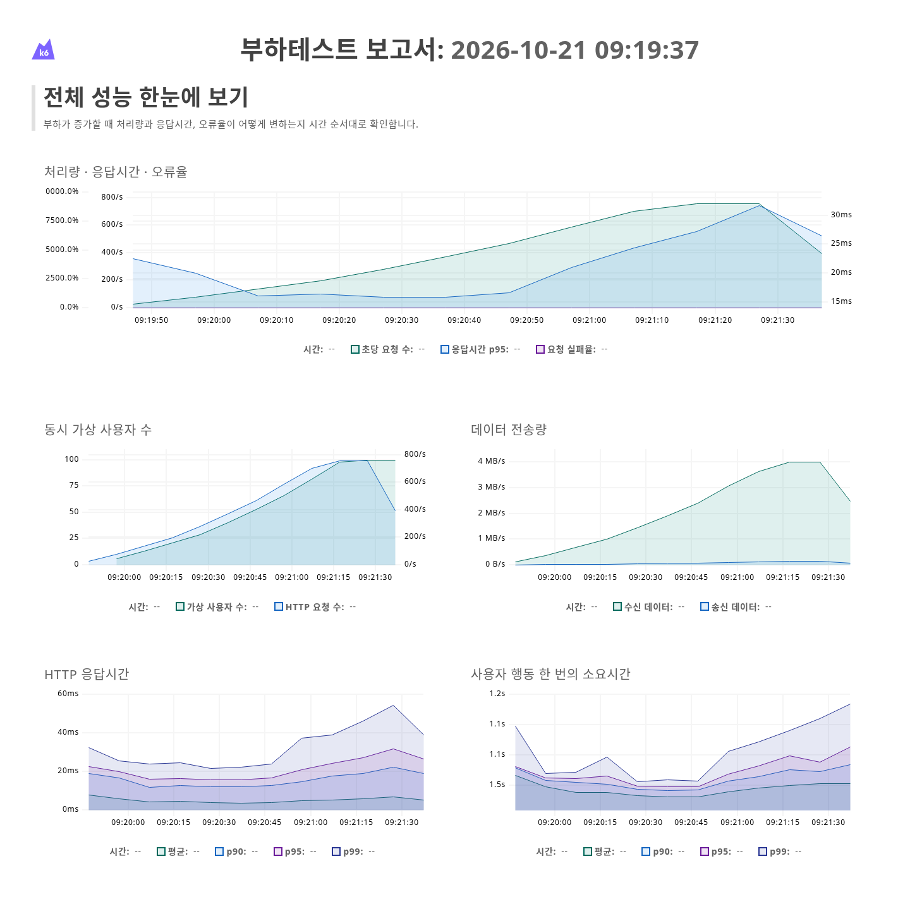

# 한국어 그래프로 보는 k6 결과

2026-10-21 한국 시간 09:19에 같은 로컬 개발환경에서 다시 실행해 k6 기본 웹 대시보드를 HTML로 내보냈다. 최대 100 VU, API 8개 순차 호출과 1초 대기, 동일한 가상 데이터 조건을 사용했다. 최초 측정 결과를 수정하지 않고 그래프를 수집한 재측정으로 별도 보관한다.

| 항목 | 재측정 결과 |
| --- | ---: |
| 총 요청 | 47,634건 |
| 평균 처리량 | 394.86 요청/초 |
| 전체 p95 | 23.14ms |
| 전체 p99 | 40.54ms |
| HTTP 실패율 | 0% |
| 응답 상태와 내용 검사 | 47,632 / 47,632 통과 |

## 직접 보는 방법

[dashboard.html](dashboard.html)을 다운로드한 뒤 Chrome이나 Edge 등 브라우저에서 연다. GitHub에서는 HTML 소스가 표시되므로 파일을 내려받아 열어야 한다. 그래프 위에 마우스를 올려 시점별 수치를 보고, 원하는 구간을 드래그해 확대한다. 더블 클릭하면 전체 범위로 돌아간다. 대시보드 시각은 여는 브라우저의 시간대를 따르며 미리보기는 한국 시간이다.

- **동시 가상 사용자 수**: 실제 부하가 최대 100명까지 증가했는지 확인한다.
- **초당 요청 수**: 초당 처리 요청 수다. 전체 평균은 부하 상승과 하강 구간을 포함한다.
- **HTTP 응답시간**: p95와 p99가 부하 증가에 따라 얼마나 상승하는지 본다.
- **요청 실패율**: 이번 재측정은 전체 구간에서 0%다.
- **전체 측정 결과 요약**: 전체 실행의 평균과 백분위수, 처리량과 응답 검사 성공률을 확인한다.

구간별 p95와 전체 p95는 집계 대상이 달라 같은 값이 아니다. 최대 100 VU까지 통과한 결과를 서버의 최대 처리 한계나 실제 동시 사용자 보장으로 해석하지 않는다. 로컬 API 테스트이며 운영 Render 서버, 인터넷 지연과 실제 가입자 데이터는 사용하지 않았다.

[전체 그래프 이미지](dashboard-preview.png) / [원본 k6 요약](summary.json) / [실무 테스트 방법과 지표 해석](../../READ-RESULTS.md)

HTML 보고서는 외부 리소스를 차단한 로컬 HTTP 미리보기에서도 차트가 표시되고 JavaScript 오류가 없음을 브라우저로 확인했다. 서버와 DB 내부 지표를 수집한 Grafana/APM 보고서는 아니다.

그래프 제목, 설명, 범례와 통계 표를 한국어로 번역했습니다. 측정 이벤트 18개와 원본 요약 JSON은 변경하지 않았습니다. [번역 도구](../../tools/localize-report.py)로 새 k6 HTML 보고서에도 같은 번역을 적용할 수 있습니다.
